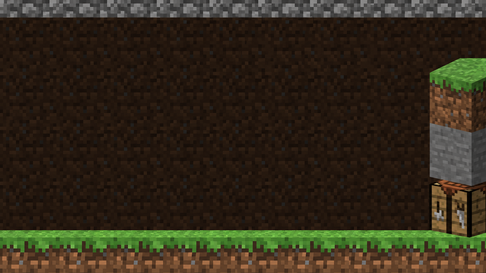
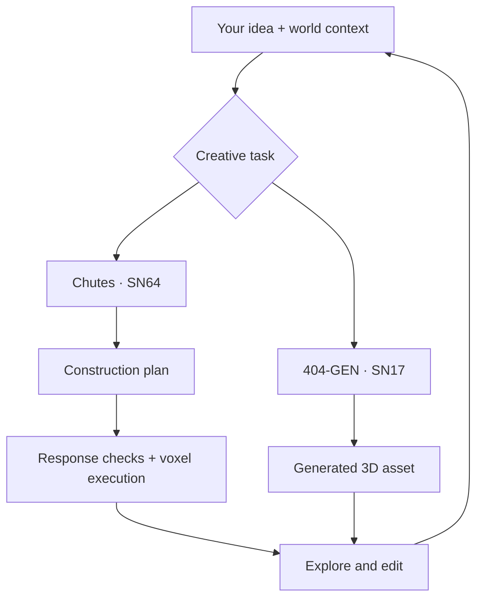

<div align="center">

# TensorCraft

### Your words. Your world.

**Turn a sentence into a world you can play.**

A Minecraft-inspired sandbox powered by Bittensor. Describe your idea, generate structures and 3D assets, and step inside your creation.

[Play Now](https://tensorcraft-bittensor.vercel.app/) ·  [Pitch Deck](presentation/TensorCraft-Bittensor-Pitch.pptx)

Built for **Bittensor Builders House** ·



</div>

## Build at the speed of imagination

Start with an idea instead of an empty world.

TensorCraft brings AI-assisted construction, 3D asset generation, and playable exploration into one creative environment. Describe a structure, explore the result, and refine it through follow-up prompts or direct block editing.

> “Build a stone tower with glowing windows.”
>
> “Add a wooden bridge from the entrance.”
>
> “Change the doorway and keep the rest.”

The AI creates an editable starting point. You keep creative control.

Designed for voxel players, hobbyists, and creators, TensorCraft makes the journey from an idea to an interactive scene part of the game itself.

## Features

- **Prompt-to-build:** turn natural-language instructions into structured construction operations.
- **Playable results:** walk through generated structures and explore them from inside the world.
- **Contextual editing:** refine builds through follow-up instructions grounded in available world context.
- **3D asset generation:** create game assets and environment elements through 404-GEN.
- **Manual building:** mine, place, and replace blocks directly.
- **Creative mode:** fly through your world and build freely.
- **Browser saves:** preserve your hosted single-player world in browser storage.
- **Multiple inference providers:** use Chutes, Anthropic, or Gemini.
- **Offline development:** run with deterministic mock responses.
- **Response validation:** check construction-plan structure and operation fields before execution.
- **Inference metadata:** capture provider, model, request ID when available, and latency.
- **Server usage controls:** persist usage and enforce budget and concurrency limits on the full Node server.

## How it works



For voxel construction, the model produces structured operations that the engine interprets and executes. TensorCraft checks response structure and required operation fields before execution.

For 3D generation, 404-GEN supplies assets and environment elements for interactive scenes.

Players inspect the results in the world, edit directly, and guide the next iteration.

## Powered by Bittensor

TensorCraft combines two Bittensor subnet capabilities in one creative workflow.

### Chutes · Subnet 64

**Construction planning and contextual edits.**

The `chutes.js` adapter sends player instructions and available world context to the Chutes chat-completions API. It processes the returned construction plan and attaches inference metadata, including provider, model, request ID when available, and latency.

**Your idea → Chutes / SN64 → Construction plan → Playable voxel world**

The adapter is implemented and tested.

[Chutes documentation](https://www.chutes.ai/docs/guides/starter-guide)

### 404-GEN · Subnet 17

**3D assets for richer interactive worlds.**

TensorCraft integrates 404-GEN for 3D asset generation, extending the creative toolkit beyond voxel construction. Generated game assets and environment elements complement AI-built structures within interactive scenes.

**Your idea → 404-GEN / SN17 → Generated 3D asset → Interactive scene**

[404-GEN official profile](https://huggingface.co/404-Gen)

### Two subnets, one creative experience

| Subnet | Role in TensorCraft |
| --- | --- |
| **Chutes · SN64** | Construction planning and contextual edits |
| **404-GEN · SN17** | 3D asset and environment-element generation |

TensorCraft turns subnet capabilities into a product players can use without managing model APIs or GPU infrastructure.

## Why TensorCraft?

A generated response is only the beginning. TensorCraft connects that response to a world you can explore.

- **Create in context:** build with the current world available to the construction workflow.
- **Step inside the result:** inspect scale, layout, and details through gameplay.
- **Keep editing:** combine follow-up prompts with precise manual changes.
- **Mix creative capabilities:** bring voxel construction and generated 3D assets into the same experience.

The core loop is simple: **describe → build → explore → refine.**

## Play now

Open [TensorCraft](https://tensorcraft-bittensor.vercel.app/), press **G**, and describe what you want to build.

The hosted demo is publicly accessible without a password.

| Control | Action |
| --- | --- |
| WASD | Move |
| Space | Jump |
| Mouse | Mine and place blocks |
| G | Open the AI Builder |
| Esc | Open the menu |
| `/gamemode creative` | Enable creative mode |
| F | Fly in creative mode |

The hosted edition is single-player and saves its world in your browser. Multiplayer, MCP agents, the nation simulation, and persistent shared worlds use the full Node server.

## Demo and pitch deck

[Watch the three-minute narrated demo](https://tensorcraft-bittensor.vercel.app/demo/TensorCraft-3-Minute-Demo.mp4)

The video replays actual AI-generated construction plans in the voxel engine using a controlled camera. It demonstrates the building experience rather than live Chutes inference or generation latency.

The same video is embedded on slide 3 of the [pitch deck](presentation/TensorCraft-Bittensor-Pitch.pptx).

## Run locally

### Install dependencies

```sh
npm ci
cp .env.example .env
```

Configure your selected provider’s credentials and `GAME_PASSWORD` in `.env`.

### Start the server

```sh
npm start
```

Open `http://localhost:8787`.

### Configure construction inference

| Provider | Configuration |
| --- | --- |
| Chutes | `PROVIDER=chutes` and `CHUTES_API_KEY` |
| Anthropic | `PROVIDER=anthropic` and corresponding credentials |
| Gemini | `PROVIDER=gemini` and corresponding credentials |
| Offline development | `MOCK=1` |

For text-only models, set `CREATOR_REVIEW=0`.

### Run tests

```sh
npm test
```

### Run with Docker

```sh
docker build -t tensorcraft .
docker run --env-file .env -p 8787:8787 -v tensorcraft-data:/app/data tensorcraft
```

The full server persists usage and enforces budget and concurrency limits. Keep the data volume attached to preserve world and budget data across restarts.

Chutes cost accounting uses estimates rather than billing receipts.

## Deploy on Vercel

The included `vercel.json` deploys `public/` and `api/`.

| Environment variable | Purpose |
| --- | --- |
| `HOSTED_LIVE_AI=1` | Enable live AI generation |
| `PROVIDER=chutes` | Select Chutes inference |
| `CHUTES_API_KEY` | Authenticate Chutes requests |
| `PROVIDER=anthropic` | Select Anthropic inference |
| `ANTHROPIC_API_KEY` | Authenticate Anthropic requests |
| `CLAUDE_MODEL` | Select the Anthropic model |
| `HOSTED_REQUIRE_PASSWORD=1` | Require a password |
| `GAME_PASSWORD` | Set the access password |

Without `HOSTED_LIVE_AI=1`, the hosted route serves deterministic demo blueprints.

The serverless route has no durable spending ledger. Configure provider-side quotas or use the full Node server for persistent budget enforcement.

Keep credentials in ignored `.env` files or hosting secrets. Never place them in client code, commits, or presentation files.

## Built for Bittensor Builders House

**Track 3 — Build with Bittensor Subnets**

TensorCraft connects decentralized AI capabilities to an interactive creative product.

| Area | Implementation |
| --- | --- |
| **Product** | Browser-based sandbox with AI-assisted creation |
| **Gameplay** | Describe, build, explore, and edit |
| **Construction inference** | Chutes / SN64 integration |
| **3D generation** | 404-GEN / SN17 integration |
| **Execution** | Structured operations, response checks, and inference metadata |
| **Distribution** | Hosted game, narrated demo, and pitch deck |

---

<div align="center">

### Describe an idea. Watch it become a world. Step inside.

[Play TensorCraft](https://tensorcraft-bittensor.vercel.app/)

</div>
